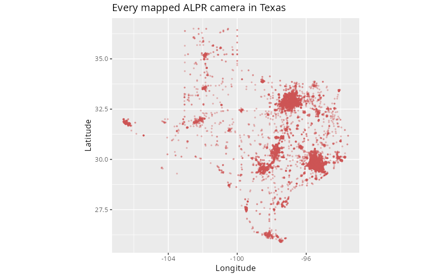
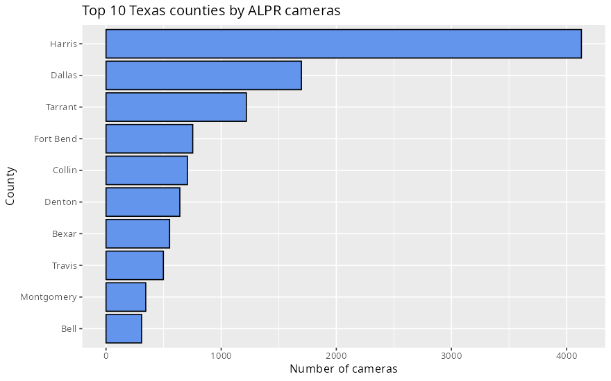
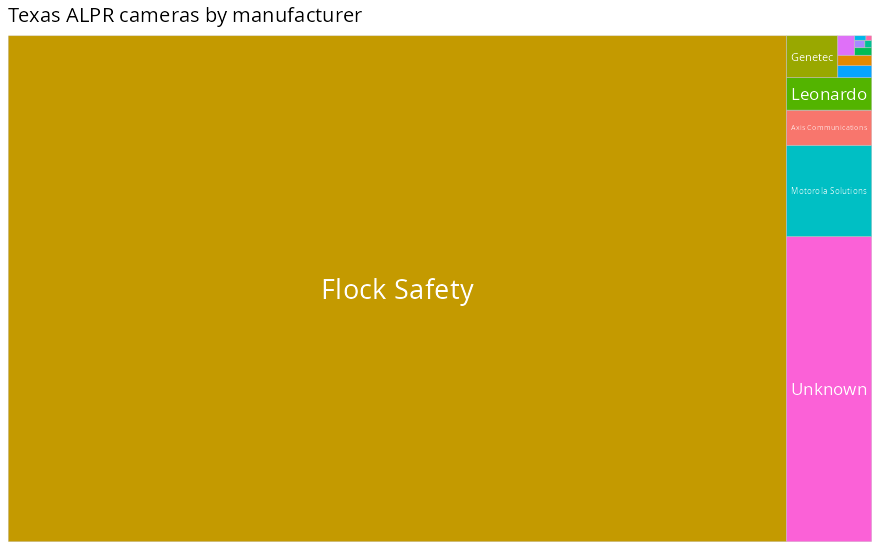
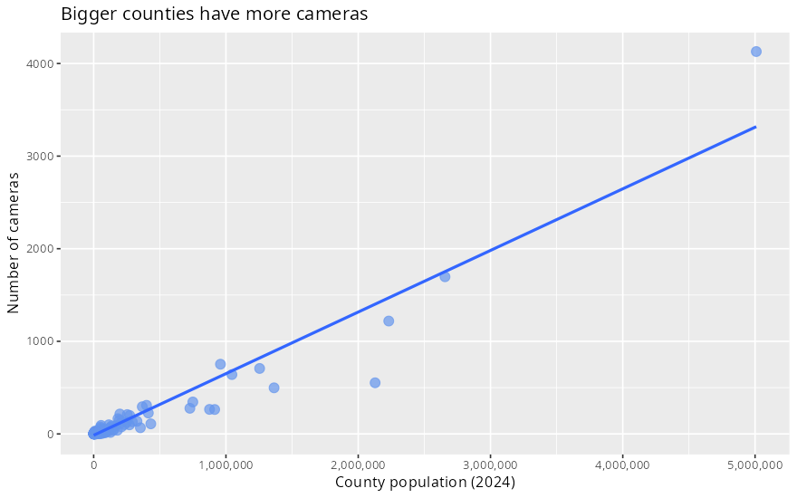
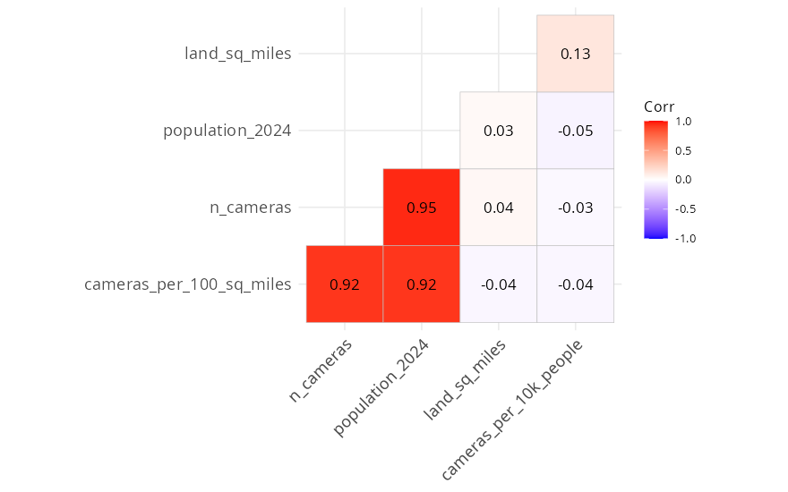
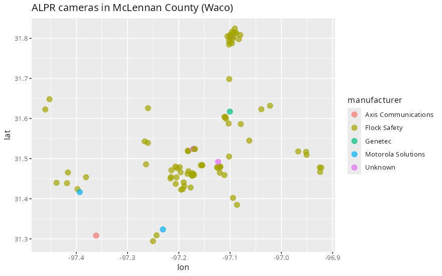

# Texas License Plate Reader (ALPR) Cameras

**Business Intelligence project proposal: sample dataset**

This project looks at where automated license plate reader (ALPR) cameras are installed across Texas, who makes them, and which counties have the most cameras compared to their population and size.

## The data

| File | Rows | What one row is |
| --- | --- | --- |
| [`data/texas_alpr_cameras.csv`](data/texas_alpr_cameras.csv) | **17,231** | One ALPR camera in Texas |
| [`data/texas_alpr_by_county.csv`](data/texas_alpr_by_county.csv) | 254 | One Texas county (camera count + population + area) |
| [`data/waco_cameras.csv`](data/waco_cameras.csv) | 52 | Every surveillance camera in Waco (50 are ALPR) |

### Camera-level columns (`texas_alpr_cameras.csv`)

| Column | Type | Example |
| --- | --- | --- |
| `osm_id` | ID | 31431226 |
| `lat`, `lon` | numeric (location) | 31.5185, -97.1820 |
| `county`, `county_fips` | categorical | McLennan, 48309 |
| `manufacturer` | categorical | Flock Safety, Motorola Solutions, Axis, Genetec... |
| `operator` | categorical | Dallas Police Department, Lowe's, Customs and Border Protection... |
| `surveillance` | categorical | public / private |
| `surveillance_zone` | categorical | traffic, parking, street, entrance |
| `camera_type` | categorical | fixed |
| `camera_mount` | categorical | pole, traffic_signals, street_lamp, wall |
| `direction` | numeric (compass degrees) | 270 |
| `date_last_edited`, `year_last_edited` | date | 2025-09-24 |

### County-level columns (`texas_alpr_by_county.csv`)

`county`, `county_fips`, `n_cameras`, `population_2024`, `land_sq_miles`, `cameras_per_10k_people`, `cameras_per_100_sq_miles`

## Sources

- **Camera locations:** [OpenStreetMap](https://www.openstreetmap.org) via the Overpass API (`surveillance:type = ALPR`), downloaded 2026-09-28. Much of this mapping comes from the [DeFlock](https://deflock.me) volunteer project. Data © OpenStreetMap contributors, ODbL 1.0.
- **Population:** U.S. Census Bureau, Vintage 2024 county population estimates.
- **Land area:** U.S. Census Bureau 2023 Gazetteer files.
- **Counties:** each camera was matched to its county by its latitude/longitude (60 cameras on the coastline/border edges have no county).

## First look

| | |
| --- | --- |
|  |  |
|  |  |
|  |  |

**Quick findings**
- About 90% of mapped cameras are made by **Flock Safety** (15,511 of 17,231).
- Harris County (Houston) has the most cameras (4,129), followed by Dallas (1,697) and Tarrant (1,219).
- Per person, **Kaufman County** leads large counties with 10.9 cameras per 10,000 people. McLennan County (Waco) has 98 cameras, which is 3.6 per 10,000 people.
- Camera count and population are strongly correlated (r = 0.95).

## Possible BI questions

1. Which counties have the most cameras per person, and why might that be?
2. How concentrated is the market? (Flock Safety vs everyone else)
3. Who operates the cameras: police, retailers (Lowe's, Home Depot), or federal agencies (CBP)?
4. Are cameras mostly on traffic roads, parking lots, or neighborhood entrances?
5. How fast has mapping grown (2023 to 2026)?

## Limitations

- OpenStreetMap is crowd-sourced, so it shows cameras **that volunteers have mapped**. The real number is likely higher.
- `year_last_edited` is when the map entry was last edited, not the camera install date.
- Manufacturer names need a little cleaning ("Flock", "FLOCK SAFETY" → "Flock Safety"). The analysis script does this.

## How to run

Open the folder in RStudio and set the working directory to this project folder.

```r
install.packages(c("tidyverse", "treemapify", "ggcorrplot", "osmdata"))
source("R/02_texas_alpr_analysis.R")   # analysis + all charts above
```

- `R/01_waco_alpr_cameras.R`: downloads the Waco cameras straight from OpenStreetMap with `osmdata`
- `R/02_texas_alpr_analysis.R`: loads the Texas CSVs and makes the charts (dplyr + ggplot2)
